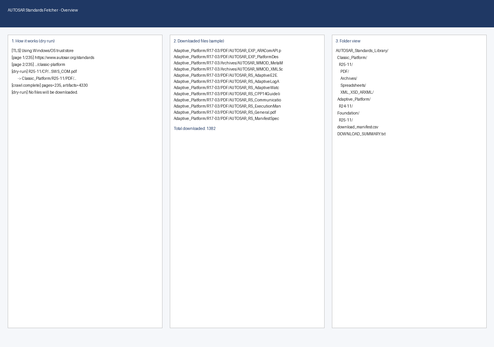

# AUTOSAR Standards Downloader — Classic, Adaptive and Foundation



This is a Windows-ready downloader for **publicly linked artifacts on the official AUTOSAR website**. It crawls the standards landing pages and linked release/search pages, discovers downloadable artifacts, and stores them in release- and file-type-oriented folders. It is designed to resume after interruption and to keep a CSV manifest containing source URLs, local paths, byte sizes, SHA-256 checksums, status, and errors.

## Official starting pages

- Standards landing page: <https://www.autosar.org/standards>
- Classic Platform: <https://www.autosar.org/standards/classic-platform>
- Adaptive Platform: <https://www.autosar.org/standards/adaptive-platform>
- Foundation: <https://www.autosar.org/standards/foundation>
- Release R25-11 page: <https://www.autosar.org/standards/R25-11>
- Official document search: <https://www.autosar.org/search>

The site currently labels **R25-11** as the current release for Classic, Adaptive and Foundation (verify on the official site when you run this later).

## Run on Windows

1. Extract this ZIP to a writable folder, for example `D:\AUTOSAR\AUTOSAR_Standards_Downloader`.
2. Install Python 3.10+ from <https://www.python.org/downloads/windows/> if Python is not already installed. Enable **Add Python to PATH** during installation.
3. Double-click `dry_run_windows.bat` first. It will inspect public pages and show which artifact URLs and paths it can discover without downloading the binary files.
4. If you see `CERTIFICATE_VERIFY_FAILED`, double-click `fix_tls_windows.bat`. It installs optional TLS trust helpers (`truststore` and `certifi`) and then retries the dry-run. It does **not** turn off certificate validation.
5. Once the dry-run discovers artifact URLs, double-click `run_download_windows.bat` to download.
6. The library is written to `AUTOSAR_Standards_Library` beside the scripts. Re-run the batch file to resume; successful files already recorded in the manifest are skipped.

The downloader can run with Python standard-library TLS roots, but optional `truststore` and `certifi` packages improve certificate handling. Install them with `py -3 -m pip install -r requirements.txt` (or run `fix_tls_windows.bat`). Internet access to `www.autosar.org` is required on the Windows PC. On managed/corporate networks, ask IT for the approved root CA if HTTPS inspection is used; do not disable certificate verification.

The crawler now skips faceted search-filter URLs and follows the unfiltered search pagination instead. This avoids a combinatorial explosion of redundant pages while still discovering all publicly linked standards artifacts (about 4,300 documents in the current AUTOSAR search index).

### Command-line alternatives

```powershell
# Discover URLs and planned paths, without downloading binary files
py -3 .\download_autosar_standards.py --dry-run --output-dir D:\AUTOSAR\AUTOSAR_Standards_Library

# Download public linked files
py -3 .\download_autosar_standards.py --output-dir D:\AUTOSAR\AUTOSAR_Standards_Library

# Slower crawling if you want to reduce load on the official website
py -3 .\download_autosar_standards.py --delay 1.0 --output-dir D:\AUTOSAR\AUTOSAR_Standards_Library

# Use Windows/OS certificate trust store (requires: py -3 -m pip install --user truststore)
py -3 .\download_autosar_standards.py --dry-run --tls-backend truststore

# Use an approved organization CA bundle if your IT team provides one
py -3 .\download_autosar_standards.py --dry-run --ca-bundle C:\Certificates\approved-root-ca.pem
```

### Download only specific platforms, releases or file types

Use these filters to avoid downloading the whole library. Values are comma-separated.

```powershell
# Only Classic Platform, R25-11, PDFs
py -3 .\download_autosar_standards.py --platforms CP --releases R25-11 --categories PDF

# Only Adaptive and Foundation, R24-11 and R23-11
py -3 .\download_autosar_standards.py --platforms Adaptive_Platform,Foundation --releases R24-11,R23-11

# Dry-run first to verify scope
py -3 .\download_autosar_standards.py --dry-run --platforms CP --releases R25-11
```

Accepted platform forms: `CP`, `Classic_Platform`, `AP`, `Adaptive_Platform`, `FO`, `Foundation`, `AI`, `Application_Interfaces`, `Shared`, `Unclassified`.  
Releases can be written as `R25-11` or `R4.4.0` (dots are normalized automatically).  
Categories: `PDF`, `Archives`, `Spreadsheets`, `XML_XSD_ARXML`, `Office_Documents`, `Text_and_Data`, `Other`.

### Resume and retry behavior

- Re-run the same command at any time. Files already recorded as `downloaded` in `download_manifest.csv` are skipped.
- Files recorded as `error` are retried automatically.
- Interrupted runs are safe: each successful file is saved and recorded before the next one starts.
- Transient network failures are retried a few times automatically.
- Use `--max-pages` (default `10000`) if you need to cap or extend crawling. The current AUTOSAR search index needs only a few hundred pages.

## Folder layout created automatically

```text
AUTOSAR_Standards_Library/
├── Classic_Platform/
│   └── R25-11/                 # or R24-11, R4_4_0, etc., based on the source URL
│       ├── PDF/
│       ├── Archives/
│       ├── Spreadsheets/
│       ├── XML_XSD_ARXML/
│       ├── Office_Documents/
│       ├── Text_and_Data/
│       └── Other/
├── Adaptive_Platform/
│   └── <release>/...
├── Foundation/
│   └── <release>/...
├── Application_Interfaces/     # if the official source URL identifies this collection
├── Shared/                      # shared artifacts that are not platform-specific
├── Unclassified/                # source artifacts that cannot be classified confidently
├── download_manifest.csv
└── DOWNLOAD_SUMMARY.txt
```

The script identifies platforms from official URL paths (`CP`, `AP`, `FO`), standard filename prefixes and referring page context. It derives the release from the official URL path where possible, and stores files that cannot be safely assigned to a release under `Unversioned`. It categorizes `.pdf`, archive files, spreadsheets and `.xml`/`.xsd`/`.arxml` artifacts separately. It does not extract ZIP packages automatically; preserve the original ZIPs and extract them yourself when needed.

## Completeness and limitations

- The downloader gathers **public files linked from the pages and links it can reach**. If AUTOSAR loads a document list only through an interactive JavaScript endpoint or a user-specific download flow, that item may not be discovered by this generic crawler. Check `download_manifest.csv` and `DOWNLOAD_SUMMARY.txt` after a run.
- `download_manifest.csv` is the audit trail: `downloaded`, `error`, `planned` and `skipped` statuses are recorded per source URL. Failed files can be retried by re-running the script. `skipped` means the file did not match your `--platforms`, `--releases` or `--categories` filters.
- The summary also reports the selected TLS backend, page errors, and a TLS certificate error if the first connection fails. The crawler stops early on certificate-verification failure instead of pointlessly trying every seed URL.
- The script respects `robots.txt` when it can be read, uses a low request rate, restricts crawling to the official `autosar.org` standards/search areas and does not attempt authentication or bypass restrictions.
- It does not claim that every historical artifact exists online. Some releases or older artifacts may no longer be available from AUTOSAR.
- It is not a mirror service and should not be used to re-host or republish AUTOSAR material.

## AI / MCP usage

The repository also ships an MCP server so AI assistants can discover and download AUTOSAR artifacts on demand:

```powershell
# Run the MCP server over stdio
py -3 .\autosar_mcp_server.py

# Or after pip install
autosar-fetcher-mcp
```

Available tools: `autosar_versions`, `autosar_search`, `autosar_download`, `autosar_status`.

Typical AI flow:
1. `autosar_versions` to see available releases for a platform.
2. `autosar_search` with a keyword/version/platform to list matching files.
3. `autosar_download` with an exact URL or narrowed filters (set `download_all=true` to fetch all matches).
4. `autosar_status` to check progress.

A small web UI is also available:

```powershell
py -3 .\autosar_web.py --port 8080
# open http://127.0.0.1:8080
```

## Packages (pip + npm)

- Python (pip): `pip install .` then use `autosar-fetcher`, `autosar-fetcher-mcp`, `autosar-fetcher-web`. Optional AI deps: `pip install .[mcp]`.
- Node (npm): `cd packages/npm && npm install` (requires Python 3.10+ plus the pip package). Provides `autosar-fetcher` and `autosar-fetcher-mcp` wrappers and `require('autosar-standards-fetcher')` config helpers.

## AI agent design (analysis)

Bulk CLI stays untouched. The AI layer reuses it:
`discover()` crawls once and caches to `autosar_assets_cache.json`;
`autosar_versions` lists cached releases; `autosar_search` filters by
keyword/platform/release/category/filename (partial names OK);
`autosar_download` downloads one exact URL or a filtered set
(`download_all=true`, `dry_run=true` to preview); `autosar_status`
reports manifest counts. Web UI (`autosar_web.py`) mirrors the same
four calls at `/api/versions|search|download|status`. See
`docs/AI_USAGE.md` and `mcp-config-examples/` (Claude Desktop, Cursor/VS Code, pip/npm).

## Example output structure

See `examples/expected_output/` for a dummy folder layout (placeholder files only).

## Copyright and usage notice

AUTOSAR's platform pages say that files are provided for **information only**, are protected by copyright and other intellectual-property rights, and that commercial exploitation requires an appropriate license/partnership. Review AUTOSAR's current Terms of Use and each file's disclaimer. Keep this library for authorized internal/reference use and do not push the downloaded official files into a public GitHub repository or redistribute them unless your license explicitly permits it.

Official pages:
- <https://www.autosar.org/standards/classic-platform>
- <https://www.autosar.org/standards/adaptive-platform>
- <https://www.autosar.org/standards/foundation>
